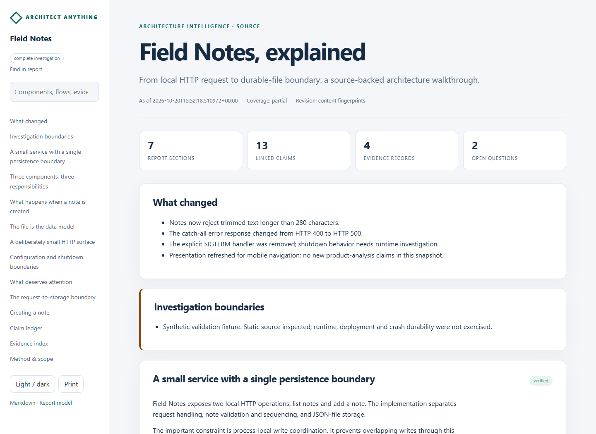
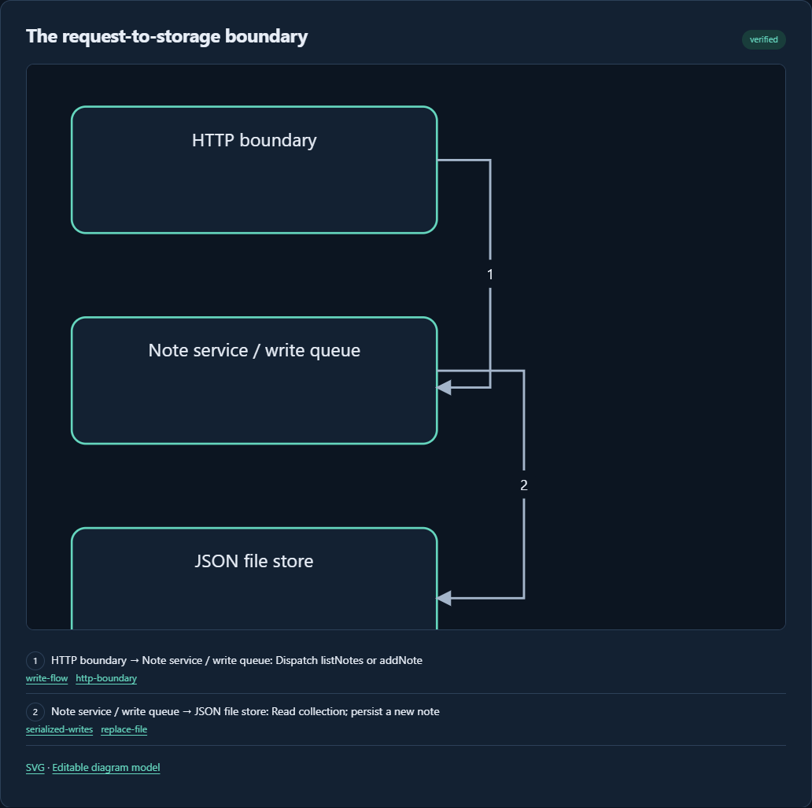

# Architect Anything

**Get back on top of your project—or find out exactly how part of an app works.**

Architect Anything is an agent skill that investigates source projects and
finished products, including applications with no source repository. It combines
repository inspection with [Reverse Engineer Anything (REA)](https://github.com/morluto/rea)
to produce detailed, evidence-backed architecture reports.

Use it when development has moved faster than your documentation, or when you
need to understand a particular feature, subsystem or design. Ask in ordinary
language; the agent investigates and produces the documents.

## What you get

- An owner briefing followed by technical detail on components, behavior, data,
  interfaces, operations, important algorithms and open questions.
- Offline HTML and matching Markdown, with search, themes, mobile navigation and
  print styling.
- Component, context, sequence, data and state diagrams, with editable models.
- Claims linked to source locations, content hashes or saved REA Evidence.
- Refresh comparisons, visible stale/unknown findings and immutable snapshots.

The skill investigates the existing system. It does not rebuild products or
present inferred behavior as observed execution.

## Install

Requirements: Python 3.10 or newer and an agent that supports local skills.
The report helpers use the Python standard library.

From a local checkout of this repository:

~~~sh
python architect-anything/scripts/install.py
~~~

This installs the skill into your Codex skills directory. The installer is
idempotent, preserves machine settings and refuses to replace independently
edited installed files.

Choose another skill destination explicitly when needed:

~~~sh
python architect-anything/scripts/install.py --destination /path/to/skills/architect-anything
~~~

For an agent with a different skill-loading mechanism, use the
[architect-anything directory](architect-anything/SKILL.md) as the skill package.
Core skill and CLI behavior has been tested in Codex; other hosts must provide
their own compatible tool access.

## Use

### Catch me up on my project

> Use $architect-anything. This project has gotten ahead of me. Explain what it
> does now, how the pieces fit together, how the important features work, and
> what changed. Give me architecture documents I can keep up to date.

The report starts with a readable owner briefing, then lets you inspect component
boundaries, feature walkthroughs, data ownership, operations and the evidence.

### Explain this part

> Use $architect-anything to explain how this app discovers and loads plugins.
> Trace it from discovery to execution, show the design, and cite the evidence.

Or ask about a screen, endpoint, algorithm, storage mechanism or lifecycle:

> How does offline sync work? How are overlapping writes prevented? What happens
> when a background job fails?

The focused report gives the direct answer and traces the relevant behavior,
including its state, interfaces, failure paths and design tradeoffs. It does not
require a whole-project report first.

### Keep the documents current

> Use $architect-anything to refresh the architecture report and explain what
> changed since the previous version.

Source-project reports default to docs/architecture/. For standalone products,
the agent selects an output directory in the working project. Focused explanations
default to their own question-specific directory under docs/architecture/focus/.
Users do not need to author JSON or run the internal helpers themselves.

## Agent-facing CLI

The skill includes a CLI for its agent to organize the investigation, resume work
and validate/publish the authored documents. Install the named command optionally:

~~~sh
python -m pip install .
architect-anything start /path/to/project
architect-anything start /path/to/app --focus "How are plugins loaded?"
architect-anything status /path/to/investigation
architect-anything finish /path/to/investigation
~~~

Start prepares a working report, evidence directory, target inventory and
mode-specific checklist. The agent still needs to investigate and explain the
system; the command does not turn a scan into a finished architecture report.
Finish refuses an uninvestigated scaffold and checks for stale evidence or changes
during collection. Useful partial findings can be published with explicit gaps.

Without package installation, the portable skill can invoke
Python architect-anything/scripts/aa_cli.py. Commands return machine-readable
JSON, stable error/exit codes, schemas and noninteractive results.
See [the agent CLI contract](architect-anything/references/agent-cli.md).

## REA integration

A complete source investigation can use normal repository tools. Finished-product
analysis uses an existing REA MCP connection, CLI or locally built runtime when
those capabilities are needed.

This repository contains the skill and report helpers. **REA, native engines,
Node.js and other providers are separate dependencies.** Installing this skill
does not register MCP servers or install analysis engines.

The routing baseline is REA 6.7.0. It covers native/managed binaries,
JavaScript/Electron, browser applications, mobile packages, firmware, game
formats, WASM, EVM, databases and recorded network/process/crash/signal evidence.
Actual availability depends on REA version, host OS and selected providers.

See [REA configuration and recovery](architect-anything/references/rea-integration.md)
and [target routing](architect-anything/references/target-routing.md).

## Try the report tools

Generate a source fixture and a complete illustrative report in a new directory:

~~~sh
python scripts/generate_demo.py --output .demo
python scripts/generate_focus_demo.py --output .cli-demo
~~~

Open .demo/reports/index.html for the project walkthrough, or
.cli-demo/reports/index.html for a focused explanation of write coordination.
The demos create inspectable fixture files and
citations on your machine; no private project or REA installation is required.
Use a new output directory for another run.

The agent performs architectural interpretation. Helpers validate and present
the authored findings; they cannot prove that prose is true or coverage is
sufficient. See [report authoring](architect-anything/references/report-authoring.md).

## Validation

~~~sh
python scripts/check_release.py
python -m unittest discover -s architect-anything/tests -v
~~~

The 35 behavioral tests cover investigation modes, publication/resume, machine
contracts, evidence/freshness, diagrams, history, comparisons, escaping and installation.
GitHub Actions is configured to run the core checks on Windows and Linux with
Python 3.10, 3.12 and 3.14.

REA integration has been exercised locally against synthetic ASAR, managed PE
and native PE fixtures, including real Ghidra analysis. Those engine-dependent
tests are not part of the dependency-free CI suite.
See [validation scope and limits](docs/validation.md).

## Release and attribution

Version 1.0.0 is prepared for the first release. See the [changelog](CHANGELOG.md),
[release notes](docs/release-1.0.0.md), and [contributing guidance](CONTRIBUTING.md).

Licensed under [MIT](LICENSE). REA attribution and its retained license are
documented in [third-party notices](THIRD_PARTY_NOTICES.md).
