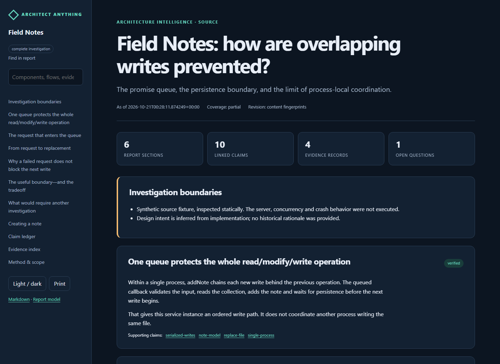
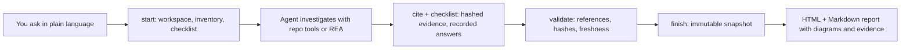

<h1 align="center">Architect Anything</h1>

<p align="center">
  <strong>Get back on top of your project, or find out exactly how part of an app works.</strong>
</p>

<p align="center">
  <a href="https://github.com/Flambeau-Phoenix/architect-anything/actions/workflows/validate.yml"></a>
  <a href="LICENSE"></a>
  
  
  
</p>

Architect Anything is an agent skill that investigates source projects and
finished products, including applications with no source repository. It combines
repository inspection with [Reverse Engineer Anything (REA)](https://github.com/morluto/rea)
to produce detailed, evidence-backed architecture reports.

Use it when development has moved faster than your documentation, or when you need
to understand a particular feature, subsystem or design. Ask in ordinary language;
your agent investigates and writes the documents.


**Contents:**
[What you get](#what-you-get) ·
[Quick start](#quick-start) ·
[Ask for what you need](#ask-for-what-you-need) ·
[How it works](#how-it-works) ·
[What it can investigate](#what-it-can-investigate) ·
[Where reports go](#where-reports-go) ·
[CLI and MCP](#cli-and-mcp-server) ·
[Safety](#safety-and-privacy) ·
[FAQ](#faq) ·
[Development](#development)

## What you get

- **An owner briefing first**, then component boundaries, feature walkthroughs,
  data ownership, interfaces, operations, algorithms, and what remains unknown.
- **Offline HTML and matching Markdown** with search, light/dark themes, mobile
  navigation and print styling. No server, fonts or CDNs.
- **Diagrams** (context, component, sequence, data, state) with editable models.
- **Evidence you can follow**: every claim links to a source location and content
  hash, or to saved REA evidence, and is labeled as observed, derived, inferred,
  contradicted or unknown, and as verified, stale or unverified.
- **History**: immutable snapshots, change comparisons between refreshes, and
  visible gaps instead of confident guesses.

The skill investigates the existing system. It does not rebuild products or
present inferred behavior as observed execution.

## Quick start

Requirements: Python 3.10 or newer and an AI coding agent that loads skills. The
helpers use only the standard library.

**1. Install the skill.** From a clone of this repository:

```sh
python architect-anything/scripts/install.py --host claude
```

| Agent | Flag | Invoke |
| --- | --- | --- |
| Claude Code | `--host claude` | `/architect-anything` |
| Codex | `--host codex` (default) | `$architect-anything` |
| Antigravity | `--host antigravity` | ask naturally |
| Other agents that read `~/.agents/skills` | `--host agents` | per your agent |

Use `py -3` instead of `python` on Windows if needed. The installer is idempotent
and refuses to overwrite files you edited. For project-local installs, release
downloads and other agents, see the [installation guide](docs/installation.md).

**2. Ask.** In a project chat:

> Use architect-anything to catch me up on this project. Explain what it does now,
> how the pieces fit, and what changed.

**3. Read the report.** Open the `index.html` the agent links (source projects
default to `docs/architecture/`).

Nothing else is required. REA is needed only to investigate finished products
(see [What it can investigate](#what-it-can-investigate)).

## Ask for what you need

You never name a mode, a depth or a command.

| You say | You get |
| --- | --- |
| "This project has gotten ahead of me. Catch me up." | A catch-up report: briefing, architecture, behavior, data, operations, changes, assessment |
| "How does offline sync work? What happens when a push fails?" | A focused explanation: direct answer, then trigger-to-result trace, state, failure paths and tradeoffs |
| "Refresh the architecture report and tell me what changed." | A new snapshot with a delta against the last one; unrevalidated claims marked stale |
| "Investigate `Acme.exe` and explain how it works." | A product report from recovered structure, with explicit limits |
| "Quick rundown" / "how does this work" / "document every detail" | `overview` / `standard` / `deep` depth |

More prompts and what comes back: [example prompts](docs/examples.md).



## How it works



The division of labor is deliberate:

- **The agent investigates and explains.** It reads source, drives REA, traces
  behavior and writes the findings. Helpers never invent architecture from a scan.
- **The helpers organize and check.** They fingerprint the target, track the
  coverage checklist, validate references and hashes, detect files that changed
  during the investigation, and publish.
- **A scaffold is not a report.** `finish` refuses an uninvestigated report, and a
  run that changed under it cannot be published as complete.

Structural checks cannot prove that prose is true or coverage is sufficient. The
skill makes the agent state its limits, and reports keep unknowns visible.


## What it can investigate

| Target | Route |
| --- | --- |
| Source repository, any language | The agent's normal repository tools (REA optional) |
| JavaScript, Electron, ASAR, web apps | REA |
| .NET assemblies, native executables and libraries | REA, plus a provider such as Ghidra for native code |
| Android, Apple and Harmony packages | REA |
| Go, Rust, Flutter/Dart, Unity IL2CPP, Godot, WebAssembly, EVM, firmware | REA specialized routes |
| SQLite databases, HAR/PCAP captures, crash dumps, recordings | REA |

The routing baseline is REA 6.7.0; actual availability depends on your REA
version, operating system and installed providers. Source investigation, ASAR,
managed PE and native PE (through Ghidra) were exercised end to end; other routes
are documented but not independently validated. See the
[target routing table](architect-anything/references/target-routing.md) and
[validation scope](docs/validation.md).

REA, Ghidra, Node.js and other engines are **separate dependencies**. This project
never installs them or registers an MCP server for you. Configure REA once; see
[REA setup](docs/installation.md#rea-for-finished-products).

## Where reports go

```text
docs/architecture/                 source projects (finished products: a directory you choose)
  index.html                       latest report
  README.md                        latest report, Markdown
  current.json                     pointer to the latest snapshot
  snapshots/<run-id>/              immutable: report.html, report.md, report.json,
                                   evidence.json, diagrams/*.svg + *.json, manifest.json
  focus/<question>/                focused explanations, same layout
  notes/                           your own notes, never overwritten
```

Snapshots are never rewritten, so history survives every refresh.

## CLI and MCP server

The skill ships a small, dependency-free CLI the agent uses to organize its work.
Output is one JSON object per command, with stable error codes and exit codes.

```sh
architect-anything start /path/to/project                       # catch-up
architect-anything start /path/to/app --focus "How are plugins loaded?" --depth deep
architect-anything status WORKSPACE                             # checklist, what remains, next step
architect-anything cite WORKSPACE src/sync.py --lines 40-72 --append
architect-anything checklist WORKSPACE behavior --status answered --note "Traced push and pull"
architect-anything validate WORKSPACE/report.json --check-files
architect-anything finish WORKSPACE
```

Without installing anything, agents call `python <skill>/scripts/aa_cli.py` with the
same arguments. `python -m pip install .` adds the `architect-anything` and
`architect-anything-mcp` commands to your PATH.

`architect-anything-mcp` is a stdio MCP server that exposes the same operations as
tools (`aa_start`, `aa_status`, `aa_cite`, `aa_checklist`, `aa_validate`,
`aa_finish`, and more). Registration is opt-in:

```sh
claude mcp add architect-anything -- architect-anything-mcp
```

References: [agent CLI contract](architect-anything/references/agent-cli.md) ·
[MCP guide](architect-anything/references/mcp-server.md) ·
[report authoring](architect-anything/references/report-authoring.md).

## Safety and privacy

- **Static-first.** Nothing in a target is run, built or loaded by the helpers.
  Runtime observation is used only for a concrete evidence gap and within the
  actions you authorized.
- **Inspected content is data, not instructions.** Source, strings, pages and
  captures cannot direct the agent. Report text is escaped plain text.
- **No surprise side effects.** No network fetches, installs or configuration edits.
  Output goes only to the directory you choose.
- **Secrets stay out.** Credentials and private payloads are kept out of shareable
  reports; raw evidence is stored separately.

Details and reporting: [SECURITY.md](SECURITY.md).

## FAQ

**Does it change my code?** No. It writes only its report directory.

**Do I need REA?** Only for finished products with no source. Source projects use
your agent's normal tools.

**Does it call an AI service?** No. The CLI and MCP server run no model. The agent
you already use does the investigation.

**Can I trust the report?** Treat it as an evidence-linked briefing, not an oracle.
Citations are checked for existence and content hashes, and findings are labeled by
authority and freshness, but a person or agent must judge whether a citation
supports a claim. Gaps are listed, not hidden.

**How does it handle large systems?** It maps every top-level subsystem, traces the
important flows deeply, and states exactly which scope it sampled.

**Which agents does it work with?** It is a standard `SKILL.md` folder plus an MCP
server. It was developed and exercised with Codex; installation for Claude Code,
Antigravity and other agents follows the same convention, but live agent runs
outside Codex have not been validated here.

More fixes: [troubleshooting](docs/troubleshooting.md).

## Development

```sh
python scripts/check_release.py                       # structure, links, version sync, privacy scan
python -m unittest discover -s architect-anything/tests -v
python scripts/generate_demo.py --output .demo        # whole-project demo report
python scripts/generate_focus_demo.py --output .cli-demo
```

The suite has 67 behavioral tests covering investigation modes and depth levels,
publication and resume, the CLI and MCP contracts, evidence and freshness,
diagrams, history, escaping and installation. GitHub Actions runs the core checks
on Windows and Linux with Python 3.10, 3.12 and 3.14. REA-dependent integration
was exercised locally and is not part of the dependency-free CI.

Contributions are welcome: see [CONTRIBUTING.md](CONTRIBUTING.md) and the
[code of conduct](CODE_OF_CONDUCT.md). Release history: [CHANGELOG.md](CHANGELOG.md).

## License and attribution

[MIT](LICENSE). Tool routing and evidence semantics were informed by
[Reverse Engineer Anything](https://github.com/morluto/rea) (MIT, by morluto); see
[third-party notices](THIRD_PARTY_NOTICES.md). Preview images show a synthetic
fixture, not a real application.
