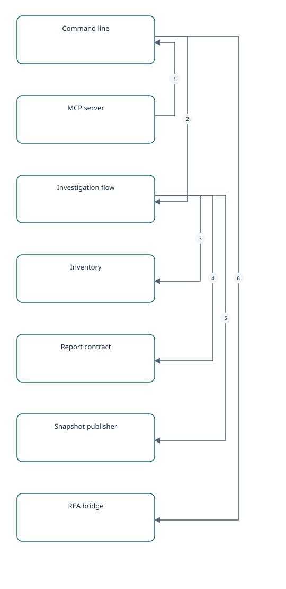
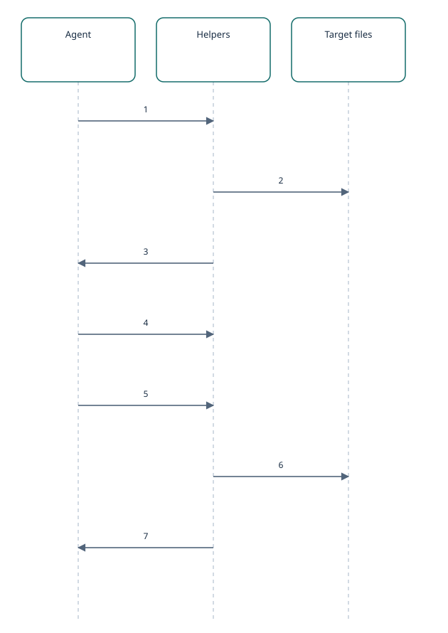

# Architect Anything: how the toolkit keeps an agent's findings checkable

A self-investigation of the repository at one commit: the workflow gates, the evidence hashes, the installer and the MCP server.

**Target:** Architect Anything · **As of:** 2026-10-21T09:30:47.759970\+00:00
**Status:** complete · **Coverage:** partial
**Revision:** 6189462d4aacaffe181bd8553802c11422b25a1a

## Investigation boundaries

- Static reading of the Python helpers at one commit. No part of the toolkit was run as part of this investigation, and the repository's own tests were not used as evidence.
- The HTML renderer, the skill's written instructions and references, the CI workflows and the REA integration beyond its configuration and receipts were not examined.
- Design intent is inferred from the code; no decision records were consulted.

## What this repository is

Freshness: **verified**

Architect Anything is a set of standard-library Python helpers, a command line and an MCP server that wrap an agent's architecture investigation. The agent reads the target and writes the findings. The helpers fingerprint the files it cites, hold the report to a strict contract and publish it as an offline snapshot.

What sets it apart is the set of refusals. An uninvestigated scaffold cannot be published, unanswered questions block a complete run, and a target that moved during the run downgrades the report. The same helpers are reachable from a shell, from an MCP client and through console scripts.

Supporting claims: [design-split](#claim-design-split), [start-scaffold](#claim-start-scaffold), [finish-gates](#claim-finish-gates), [entrypoints](#claim-entrypoints)

## The modules and what each owns

Freshness: **verified**

Each module has one job. The command line and the MCP server are two front doors onto the same investigation code, so behavior cannot drift between them. The installer and the REA bridge sit beside them and are independent of the investigation flow.

| Module | Responsibility |
| --- | --- |
| aa\_cli.py | Command parsing and dispatch |
| aa\_investigation.py | Workspace, checklist, cite and finish |
| aa\_inventory.py | Selecting, hashing and comparing target files |
| aa\_model.py | Report contract, validation and hashing |
| aa\_render.py | Publishing immutable snapshots |
| aa\_mcp.py | MCP stdio server over the same commands |
| install.py | Copying the skill into an agent's skills folder |
| rea\_bridge.py | Optional hand-off to a Reverse Engineer Anything command |

Supporting claims: [cli-surface](#claim-cli-surface), [mcp-wrapper](#claim-mcp-wrapper), [installer-guards](#claim-installer-guards), [rea-optional](#claim-rea-optional), [inventory-selection](#claim-inventory-selection)

## From start to a published snapshot

Freshness: **verified**

start creates a working folder with an inventory, a scaffold report and a checklist, and says nothing about the target. The agent investigates, adds evidence with cite and answers each checklist question with a note.

finish then refuses an unchanged scaffold and unanswered questions, takes a second inventory and compares it with the first. If anything moved the run is downgraded to partial. Otherwise publish validates the report against the files, takes a lock and writes a new snapshot that is never modified afterwards.

Supporting claims: [start-scaffold](#claim-start-scaffold), [finish-gates](#claim-finish-gates), [finish-reinventory](#claim-finish-reinventory), [publish-immutable](#claim-publish-immutable)

## Evidence, hashes and what they establish

Freshness: **verified**

A citation is a path, an optional line range and a SHA-256. Validation recomputes the hash, so a citation proves which version of the file was read, not that the claim is right. That relationship stays with the agent and the reader.

Text is hashed with line endings folded to LF so that checkouts on different systems agree. Binary files are hashed as they are, and older raw hashes remain valid.

Supporting claims: [validate-evidence](#claim-validate-evidence), [hash-normalized](#claim-hash-normalized), [inventory-selection](#claim-inventory-selection), [compare-by-hash](#claim-compare-by-hash)

## Installing and connecting it

Freshness: **verified**

The installer finds the agents on the machine unless told which one to use, copies the skill under a manifest, and will not overwrite a copy someone edited. The MCP server is a loop over standard input that answers a small set of methods and survives malformed lines.

REA is only needed for artifacts the source cannot explain. When it is used, its output is saved beside a receipt rather than overwriting earlier results.

Supporting claims: [host-detection](#claim-host-detection), [installer-guards](#claim-installer-guards), [entrypoints](#claim-entrypoints), [mcp-transport](#claim-mcp-transport), [rea-receipts](#claim-rea-receipts)

## What deserves attention

Freshness: **verified**

Two behaviors are worth knowing. A change to any selected file during a long run downgrades the whole run, so a busy editor can force a rerun of the affected findings. And comparing against an inventory made before the newline change will show CRLF files as changed once.

This is a static reading of the helpers' code at one commit. The renderer, the skill's own instructions and the CI workflows were not examined, so nothing here describes the quality of generated reports.

Supporting claims: [risk-whole-run](#claim-risk-whole-run), [risk-old-hashes](#claim-risk-old-hashes), [render-gap](#claim-render-gap)

## How the modules connect

Freshness: **verified**

1. MCP server → Command line: Reuse parser and run — [mcp-wrapper](#claim-mcp-wrapper)
2. Command line → Investigation flow: Dispatch commands — [cli-surface](#claim-cli-surface)
3. Investigation flow → Inventory: Inventory at start and finish — [finish-reinventory](#claim-finish-reinventory)
4. Investigation flow → Report contract: Hash and validate — [validate-evidence](#claim-validate-evidence), [hash-normalized](#claim-hash-normalized)
5. Investigation flow → Snapshot publisher: Publish a snapshot — [publish-immutable](#claim-publish-immutable)
6. Command line → REA bridge: Optional hand-off — [rea-optional](#claim-rea-optional)

## One investigation run

Freshness: **verified**

1. Agent → Helpers: start — [start-scaffold](#claim-start-scaffold)
2. Helpers → Target files: Inventory and hash — [inventory-selection](#claim-inventory-selection)
3. Helpers → Agent: Scaffold and checklist — [start-scaffold](#claim-start-scaffold)
4. Agent → Helpers: cite and checklist — [validate-evidence](#claim-validate-evidence), [finish-gates](#claim-finish-gates)
5. Agent → Helpers: finish — [finish-gates](#claim-finish-gates)
6. Helpers → Target files: Inventory again — [finish-reinventory](#claim-finish-reinventory)
7. Helpers → Agent: Snapshot or refusal — [publish-immutable](#claim-publish-immutable), [finish-reinventory](#claim-finish-reinventory)

## Claim ledger

**start-scaffold · observation · verified**

start validates its options, inventories the target and writes a working report whose claims are all unknown and whose limitations carry a scaffold marker. It records a checklist of unresolved questions and does not analyze the target.

Evidence: [e-start](#evidence-e-start)

**finish-gates · observation · verified**

finish refuses a report that is still the scaffold, refuses unresolved checklist items unless --partial is given, and requires an explanatory note on every resolved item.

Evidence: [e-finish](#evidence-e-finish)

**finish-reinventory · observation · verified**

finish inventories the target again. If any file was added, removed or changed, or the selected coverage differs, it marks the run partial and, without --partial, refuses to publish.

Evidence: [e-finish](#evidence-e-finish)

**publish-immutable · observation · verified**

publish validates the report first, takes an exclusive lock file, refuses to overwrite an index.html or README.md that was edited by hand, and writes each run into a new snapshot directory that must not already exist.

Evidence: [e-publish](#evidence-e-publish)

**validate-evidence · observation · verified**

With file checking on, validation compares each cited file's current hash with the recorded SHA-256 and flags a missing file, a changed fingerprint or a line range outside the file. The problem is an error unless every claim that depends on the evidence is unverified, in which case it is only a warning.

Evidence: [e-validate](#evidence-e-validate)

**hash-normalized · observation · verified**

Source citations and inventories hash text with CRLF folded to LF and hash binary files byte for byte. Validation accepts either the normalized or the older raw-byte hash.

Evidence: [e-digest](#evidence-e-digest), [e-cite](#evidence-e-cite), [e-inventory](#evidence-e-inventory)

**inventory-selection · observation · verified**

The inventory skips .git, dependency and cache directories and docs/architecture by default, hashes the selected files, and records files that changed while being hashed, omissions and errors instead of hiding them.

Evidence: [e-excludes](#evidence-e-excludes), [e-inventory](#evidence-e-inventory)

**compare-by-hash · observation · verified**

compare\_inventory classifies each path by its SHA-256 and treats a different selection source, exclusion list, error list or non-exclusion omission as a change in coverage, which makes the comparison not comparable.

Evidence: [e-compare](#evidence-e-compare)

**cli-surface · observation · verified**

The command line dispatches start, status, checklist, cite, finish, schema, inventory, diff, compare, validate, render, rea and install-skill commands from one run function.

Evidence: [e-cli](#evidence-e-cli)

**mcp-wrapper · observation · verified**

The MCP server is a standard-library stdio JSON-RPC layer. Each tool call is turned into CLI arguments and run through the same parser and run function, and failures come back with the CLI's error codes. Its documentation states that it never executes inspected targets.

Evidence: [e-mcp-top](#evidence-e-mcp-top), [e-mcp-call](#evidence-e-mcp-call)

**mcp-transport · observation · verified**

The server answers initialize, ping, tools/list and tools/call, returns a method-not-found error for anything else, answers malformed JSON with a parse error and keeps reading.

Evidence: [e-mcp-handle](#evidence-e-mcp-handle), [e-mcp-main](#evidence-e-mcp-main)

**installer-guards · observation · verified**

The installer requires the destination folder to be named architect-anything and separate from the source, refuses to replace files that differ from the manifest of the last install, stages the copy in a sibling temporary folder and keeps backups outside the skills directory.

Evidence: [e-install](#evidence-e-install)

**host-detection · observation · verified**

Run with neither --host nor --destination, the installer installs for every agent whose configuration folder exists \(Claude, Codex, ~/.agents and Antigravity's ~/.gemini\) and fails with a message naming what it looked for when none does. An explicit --host or --destination skips detection.

Evidence: [e-host](#evidence-e-host), [e-install-main](#evidence-e-install-main)

**rea-optional · observation · verified**

REA is optional for a complete source investigation. The bridge finds an REA command from a config file, an environment variable, a local setting or the PATH, and fails with an explicit message when none is available.

Evidence: [e-skill-rea](#evidence-e-skill-rea), [e-rea-config](#evidence-e-rea-config)

**rea-receipts · observation · verified**

Running REA through the bridge writes its output and a stderr sidecar with exclusive creation, so an earlier result is not overwritten, and records a receipt with the exit code and the output's SHA-256.

Evidence: [e-rea-run](#evidence-e-rea-run)

**entrypoints · observation · verified**

The package declares architect-anything and architect-anything-mcp console scripts.

Evidence: [e-pyproject](#evidence-e-pyproject)

**design-split · derived · verified**

The code keeps interpretation with the investigating agent and puts the checks in deterministic helpers: a scaffold cannot be published as a finding, a complete run is re-checked against the target, and a cited file that changed fails validation.

Evidence: [e-start](#evidence-e-start), [e-finish](#evidence-e-finish), [e-validate](#evidence-e-validate)

**risk-old-hashes · derived · verified**

Reports and inventories written before the newline change hashed CRLF files byte for byte. Validation still accepts them, but comparing a new inventory with an older one lists a CRLF file as changed, once.

Evidence: [e-digest](#evidence-e-digest), [e-compare](#evidence-e-compare)

**risk-whole-run · derived · verified**

finish reacts to a change in any selected file by marking the whole run partial and refusing to publish. It does not narrow the effect to the citations of the file that changed.

Evidence: [e-finish](#evidence-e-finish)

**render-gap · unknown · verified**

How the HTML report is rendered \(search, themes, diagrams\), what the skill's written instructions steer an agent to do, and how the CI workflows run were not examined in this investigation.

Evidence: Not established

## Evidence index

### e-start

[architect-anything/scripts/aa\_investigation.py:131-216](<file:///C:/tools/aa-sample/architect-anything/architect-anything/scripts/aa_investigation.py>) · lines 131–216

start: option checks, inventory, scaffold report and checklist

sha256: 4789823f72111690be191e0a6ff7132c8f6de8978588d5b2b4e447e97725b234

### e-finish

[architect-anything/scripts/aa\_investigation.py:358-418](<file:///C:/tools/aa-sample/architect-anything/architect-anything/scripts/aa_investigation.py>) · lines 358–418

finish: scaffold refusal, checklist gate, end inventory, publish

sha256: 4789823f72111690be191e0a6ff7132c8f6de8978588d5b2b4e447e97725b234

### e-cite

[architect-anything/scripts/aa\_investigation.py:305-357](<file:///C:/tools/aa-sample/architect-anything/architect-anything/scripts/aa_investigation.py>) · lines 305–357

cite: hashed evidence record for a file and line range

sha256: 4789823f72111690be191e0a6ff7132c8f6de8978588d5b2b4e447e97725b234

### e-digest

[architect-anything/scripts/aa\_model.py:23-52](<file:///C:/tools/aa-sample/architect-anything/architect-anything/scripts/aa_model.py>) · lines 23–52

digest, text\_digest and digest\_matches

sha256: 5e7d05e3c2b64b88f3e4edcf0199f90da1332a408c8ba529c9c0943baadd6f35

### e-validate

[architect-anything/scripts/aa\_model.py:186-204](<file:///C:/tools/aa-sample/architect-anything/architect-anything/scripts/aa_model.py>) · lines 186–204

validate --check-files: fingerprint and line-range checks

sha256: 5e7d05e3c2b64b88f3e4edcf0199f90da1332a408c8ba529c9c0943baadd6f35

### e-excludes

[architect-anything/scripts/aa\_inventory.py:14-16](<file:///C:/tools/aa-sample/architect-anything/architect-anything/scripts/aa_inventory.py>) · lines 14–16

default inventory exclusions

sha256: f4d6a2e773802623a79bf2632d1c86ff5694bec3a09a49f4896b2ce63161c5af

### e-inventory

[architect-anything/scripts/aa\_inventory.py:26-100](<file:///C:/tools/aa-sample/architect-anything/architect-anything/scripts/aa_inventory.py>) · lines 26–100

inventory: selection, hashing, stability, omissions

sha256: f4d6a2e773802623a79bf2632d1c86ff5694bec3a09a49f4896b2ce63161c5af

### e-compare

[architect-anything/scripts/aa\_inventory.py:107-125](<file:///C:/tools/aa-sample/architect-anything/architect-anything/scripts/aa_inventory.py>) · lines 107–125

compare\_inventory: hash comparison and coverage change

sha256: f4d6a2e773802623a79bf2632d1c86ff5694bec3a09a49f4896b2ce63161c5af

### e-publish

[architect-anything/scripts/aa\_render.py:217-262](<file:///C:/tools/aa-sample/architect-anything/architect-anything/scripts/aa_render.py>) · lines 217–262

publish: validate, lock, immutable snapshot, pointers

sha256: 894af10dc7f4ccb5d4aa13678c73bcc73cb0216c82f4d25cedb41b26eb77ed98

### e-mcp-top

[architect-anything/scripts/aa\_mcp.py:1-8](<file:///C:/tools/aa-sample/architect-anything/architect-anything/scripts/aa_mcp.py>) · lines 1–8

MCP server contract

sha256: 1eeeb89b7ff1b7040556a0f3de0a7fe3102f5ada6909c4b92f71883d1bebae94

### e-mcp-call

[architect-anything/scripts/aa\_mcp.py:124-146](<file:///C:/tools/aa-sample/architect-anything/architect-anything/scripts/aa_mcp.py>) · lines 124–146

call\_tool: MCP calls run through the CLI parser and run\(\)

sha256: 1eeeb89b7ff1b7040556a0f3de0a7fe3102f5ada6909c4b92f71883d1bebae94

### e-mcp-handle

[architect-anything/scripts/aa\_mcp.py:147-174](<file:///C:/tools/aa-sample/architect-anything/architect-anything/scripts/aa_mcp.py>) · lines 147–174

handle: JSON-RPC methods and error codes

sha256: 1eeeb89b7ff1b7040556a0f3de0a7fe3102f5ada6909c4b92f71883d1bebae94

### e-mcp-main

[architect-anything/scripts/aa\_mcp.py:175-195](<file:///C:/tools/aa-sample/architect-anything/architect-anything/scripts/aa_mcp.py>) · lines 175–195

main: stdio loop that survives bad input

sha256: 1eeeb89b7ff1b7040556a0f3de0a7fe3102f5ada6909c4b92f71883d1bebae94

### e-cli

[architect-anything/scripts/aa\_cli.py:136-192](<file:///C:/tools/aa-sample/architect-anything/architect-anything/scripts/aa_cli.py>) · lines 136–192

run: command dispatch

sha256: 4d88d3c0ef8283780421958645d01dd67ece4a8a4eabc2003da3a61e6ce94c5f

### e-host

[architect-anything/scripts/install.py:29-40](<file:///C:/tools/aa-sample/architect-anything/architect-anything/scripts/install.py>) · lines 29–40

host\_root and detect\_hosts

sha256: 5ab0b1991385db09151c043ba1e712090df1e44f257428b1494fc9951deab880

### e-install

[architect-anything/scripts/install.py:41-60](<file:///C:/tools/aa-sample/architect-anything/architect-anything/scripts/install.py>) · lines 41–60

install: destination and integrity guards

sha256: 5ab0b1991385db09151c043ba1e712090df1e44f257428b1494fc9951deab880

### e-install-main

[architect-anything/scripts/install.py:103-120](<file:///C:/tools/aa-sample/architect-anything/architect-anything/scripts/install.py>) · lines 103–120

installer entry point

sha256: 5ab0b1991385db09151c043ba1e712090df1e44f257428b1494fc9951deab880

### e-rea-config

[architect-anything/scripts/rea\_bridge.py:15-35](<file:///C:/tools/aa-sample/architect-anything/architect-anything/scripts/rea_bridge.py>) · lines 15–35

REA CLI discovery

sha256: 50cf87c612a08c2508e346e9fb84b9a61f1b2ac98e0dbcc9138f947ebb71f5f3

### e-rea-run

[architect-anything/scripts/rea\_bridge.py:56-78](<file:///C:/tools/aa-sample/architect-anything/architect-anything/scripts/rea_bridge.py>) · lines 56–78

REA run output, sidecar and receipt

sha256: 50cf87c612a08c2508e346e9fb84b9a61f1b2ac98e0dbcc9138f947ebb71f5f3

### e-skill-rea

[architect-anything/SKILL.md:118-123](<file:///C:/tools/aa-sample/architect-anything/architect-anything/SKILL.md>) · lines 118–123

REA is optional for source investigations

sha256: f6f5f749fa4ee803885805b8821ab554970c7997ffcd78807643cd2e32d8faed

### e-pyproject

[pyproject.toml:39-42](<file:///C:/tools/aa-sample/architect-anything/pyproject.toml>) · lines 39–42

console script entry points

sha256: 52c74aba3bba8b8ce9c01dfa4752308a52312a4dbcb86d643a843f3de03b06f0

## Method & scope

Tools:
- Architect Anything 1.1.0

Exclusions:
